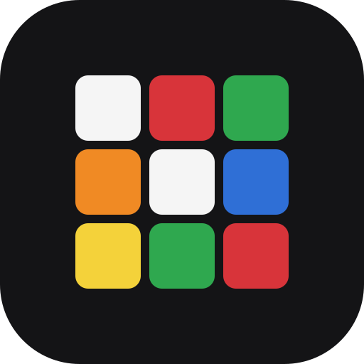

# Cadence

A speedcubing timer for the desktop, the browser and your phone. It keeps out of the way while you solve and tells you what changed afterwards.

**Open it now at [timer.serendeep.app](https://timer.serendeep.app)**, or download the desktop app from [Releases](https://github.com/Serendeep/cadence/releases/latest).

- **Focus timer.** Everything but the time fades out while you solve. Hold space (or touch) until the time turns green, release to start, press any key to stop. WCA inspection calls out 8 s and 12 s and applies +2 or DNF for you.
- **Phases.** Tap space at the end of each phase for cross, F2L, OLL and PLL splits, or let a smart cube detect them.
- **Every WCA event**, with scrambles and previews from cubing.js.
- **Inputs:** keyboard and touch, a Stackmat through the audio jack, the GAN Smart Timer, and Bluetooth smart cubes: GAN (Gen 2, 3 and 4), MoYu V10 AI / MoYu32, MoYu WeiLong AI, GiiKER, GoCube, QiYi and HeyKube.
- **Smart cube lab.** A 3D cube follows your turns and, on cubes with a gyroscope, the way you hold it. The app guides your scramble, starts on your first turn, stops when the cube is solved, splits the solve into CFOP phases, counts whole-cube rotations and keeps every move for a 3D replay.
- **Insights:** WCA averages from ao5 to ao1000, progress with rolling averages, the spread of your times, day-by-day trends, phase breakdowns and a PB timeline.
- **Coming from csTimer?** Export there, drop the file on Cadence's Settings page, check the preview and import. Importing the same file again adds nothing, and a newer export only adds the solves you did since.
- **Sync, if you want it.** Sign in with your WCA account to keep sessions, solves and settings the same on every device. Without signing in, everything stays on your device.

## Install

**On a phone or any browser,** open [timer.serendeep.app](https://timer.serendeep.app). In Chrome or Edge, tap Install when the app offers it, or use Settings > Install the app. On an iPhone, tap Share, then Add to Home Screen. The installed app works offline and updates itself; a Reload button appears when a new version is ready.

**On a computer,** download the file for your system from [Releases](https://github.com/Serendeep/cadence/releases/latest). The builds are not code-signed, so each system asks once before the first launch.

- **Windows:** run the `.exe`. It installs for your user only, without an admin prompt, and opens when it is done. When SmartScreen shows "Windows protected your PC", click More info, then Run anyway.
- **macOS:** open the `.dmg` (`arm64` for Apple silicon, the other one for Intel) and drag the app to Applications. On first launch macOS refuses to open it; go to System Settings > Privacy & Security and click Open Anyway. If macOS says the app is damaged, run `xattr -cr /Applications/Cadence.app` in Terminal.
- **Linux:** the `.AppImage` runs anywhere after `chmod +x Cadence-*.AppImage`. There are also `.deb` and `.pacman` packages (`sudo apt install ./cadence_*.deb`, `sudo pacman -U cadence-*.pacman`).

The app checks for a new version at launch and every six hours. On Windows and with the AppImage it downloads the update and offers a restart. On macOS and with the `.deb` or `.pacman` packages it links you to the download instead, because unsigned Mac apps can't replace themselves and the package manager owns those installs.

## Your data

Solves live in your browser's or the desktop app's own database. Nothing leaves the device unless you do one of two things:

- **Sign in to sync.** Your sessions, solves and settings are stored under your WCA account on Cadence's server so your other devices can fetch them. Settings > Delete synced data erases that copy.
- **Turn on Share diagnostics.** Cadence then sends device connection steps and error messages, never solves, times or your name.

## Documentation

- [User guide](docs/user-guide.md): timing, sessions, inspection, phases, Insights, import and export, sync.
- [Smart cubes and timers](docs/smart-cubes.md): connecting each device, the smart cube lab, rotations, and fixing Bluetooth.
- For contributors: [development](docs/development.md), [architecture](docs/architecture.md), [sync and sign-in](docs/sync.md), [device protocols](docs/device-protocols.md) and [deploying and releasing](docs/releasing.md).

## Development

```bash
npm install
npm run dev        # browser at http://localhost:5173
npm run desktop    # the same app inside Electron, with hot reload
npm test
```

[docs/development.md](docs/development.md) covers the rest, including running the sync server locally.

## Support

Cadence is free and has no ads. If it helps your solving, you can [buy me a coffee](https://buymeacoffee.com/serendeep).

## Licence

GPL-3.0-or-later. The MoYu drivers, the GAN timer protocol, the Stackmat protocol and the inspection voices are adapted from [csTimer](https://github.com/cs0x7f/cstimer) by Shuang Chen. Scrambles and 3D cubes come from [cubing.js](https://github.com/cubing/cubing.js); GAN cube support from [gan-web-bluetooth](https://github.com/afedotov/gan-web-bluetooth).
